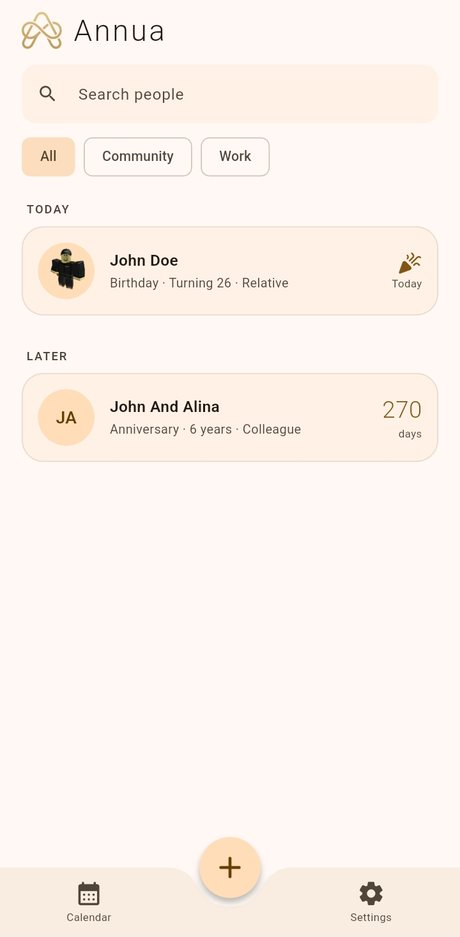
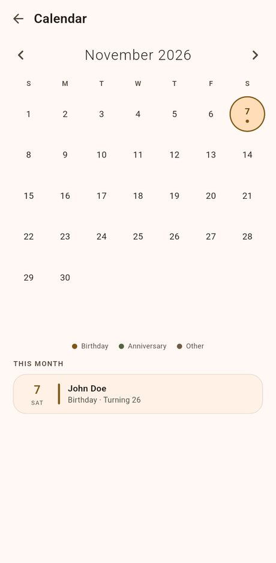
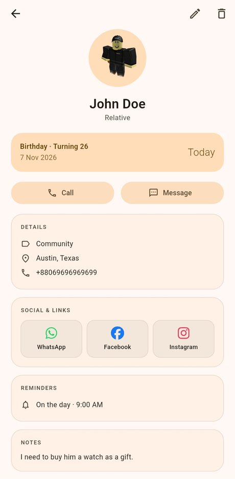
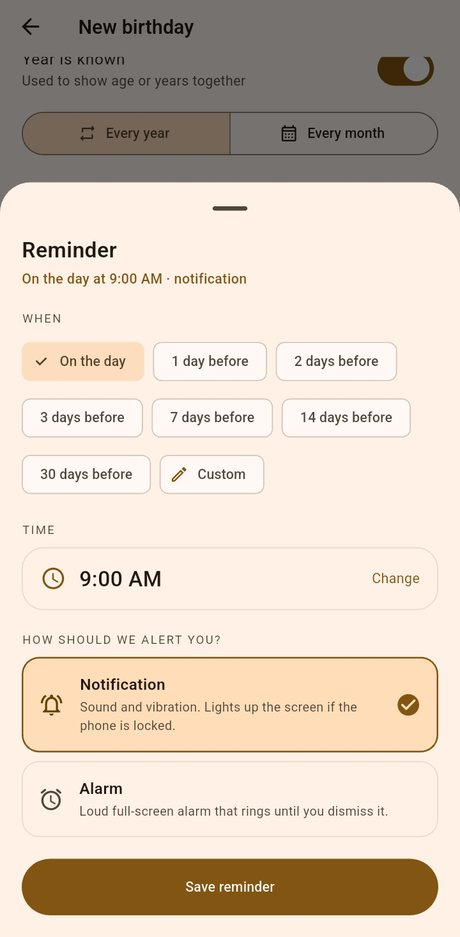

<p align="center">
  
</p>

<h1 align="center">Annua</h1>

<p align="center">
  Never miss a birthday or an event.<br>
  A calm, private reminder app for Android. No account, no ads, no tracking.
</p>

<p align="center">
  <a href="https://github.com/Zeroex-0X/Annua/releases/latest"></a>
  <a href="https://github.com/Zeroex-0X/Annua/releases"></a>
  <a href="https://github.com/Zeroex-0X/Annua/actions/workflows/build.yml"></a>
  <a href="LICENSE"></a>
  
  
</p>

<p align="center">
  <a href="https://github.com/Zeroex-0X/Annua/releases/latest/download/Annua.apk"><b>Download the latest APK</b></a>
  &nbsp;·&nbsp;
  <a href="https://zeroex-0x.github.io/Annua/">Website</a>
  &nbsp;·&nbsp;
  <a href="https://zeroex-0x.github.io/support.html">Support the developer</a>
</p>

<p align="center">
  
  
  
  
</p>

## Why Annua

Most reminder apps want an account, a cloud and your contacts. Annua keeps a short list of the people and dates that matter, on your phone only, and makes sure you hear about them on time.

## Features

- **Birthdays, anniversaries and custom events**, each with a photo, relationship and category
- **Calendar view** that highlights every day with an event; tap a day to see who is celebrating
- **Two alert styles**: a notification (sound and vibration, lights the screen on a locked phone) or a loud full-screen alarm that rings until you dismiss it
- **Flexible timing**: remind on the day or any number of days before, at a time you choose, for yearly or monthly events
- **Your own sounds**: separate sounds for notifications, birthday alarms and event alarms, or pick any sound from the phone
- **Contacts and social links**: several numbers and accounts per person, with country codes; call, message or open WhatsApp, Facebook, Instagram, Telegram and more in one tap
- **Backup and restore** to a JSON file you control (export, share, import)
- **Themes**: light, dark or automatic, pure black for OLED, accent colours or your wallpaper colours
- **Update on your terms**: Settings, then App update, shows what changed and lets you decide

## Download and install

1. Get **[Annua.apk](https://github.com/Zeroex-0X/Annua/releases/latest/download/Annua.apk)** from the [latest release](https://github.com/Zeroex-0X/Annua/releases/latest).
2. Open the file. If Android asks, allow installing from your browser or file manager.
3. Open Annua and allow the permissions below so reminders arrive on time.

Every release is signed with the same key, so a new version installs over the old one and keeps your data. You can also update from inside the app.

### Permissions

| Permission | Why |
|---|---|
| Notifications | Show reminders |
| Alarms and reminders (exact alarms) | Deliver reminders at the exact minute |
| Full-screen notifications | Light up the screen for reminders on a locked phone |
| Ignore battery optimisation | Stop the phone from delaying reminders |
| Internet | Check for new versions and open links; nothing else |

## Privacy

- No account, no analytics, no ads, no tracking
- Events, photos and settings are stored only on your device
- The only network request is the optional update check against this repository's GitHub releases
- Backups are plain files you create and keep yourself

## Build from source

Annua is a Flutter app. This repository contains the Dart sources, assets and the build workflow. The Android platform project is generated and patched by CI, so `android/` is not committed.

The full recipe is in [`.github/workflows/build.yml`](.github/workflows/build.yml): it creates the project with `flutter create --org com.zeroex --project-name annua`, copies `android_res/` and `android_native/` into it, patches the manifest and runs `flutter build apk --release`.

To build your own signed APK, fork the repository, add these Actions secrets and push a tag such as `v1.0.0`:

| Secret | Value |
|---|---|
| `KEYSTORE_BASE64` | your keystore file, base64 encoded on one line |
| `KEY_ALIAS` | the key alias |
| `STORE_PASSWORD` | the keystore password |
| `KEY_PASSWORD` | the key password |

Without the secrets the workflow still builds, but signs with a temporary debug key.

```
lib/            Dart sources (screens, services, models, widgets)
assets/         Logo, icons and brand SVGs
android_res/    Notification icons and default sounds copied into the Android project
android_native/ Small Kotlin helper for the system sound picker
docs/           The project website (GitHub Pages)
```

## Contributing

Bug reports and ideas are welcome in [Issues](https://github.com/Zeroex-0X/Annua/issues). For code changes, please open an issue first so we can agree on the approach.

## Credits

- Brand icons in `assets/brands/` are from [Font Awesome Free](https://fontawesome.com/) (icons: CC BY 4.0)
- Built with [Flutter](https://flutter.dev/) and the packages listed in [`pubspec.yaml`](pubspec.yaml)

## License

Annua is free software, licensed under the **GNU General Public License v3.0 or later**. See [LICENSE](LICENSE).

The names **Annua** and **Zeroex** and their logos identify the original project. If you publish a modified version, please use your own name and logo.

---

<p align="center">From <b>Zeroex</b> · <a href="https://zeroex-0x.github.io/">zeroex-0x.github.io</a></p>
